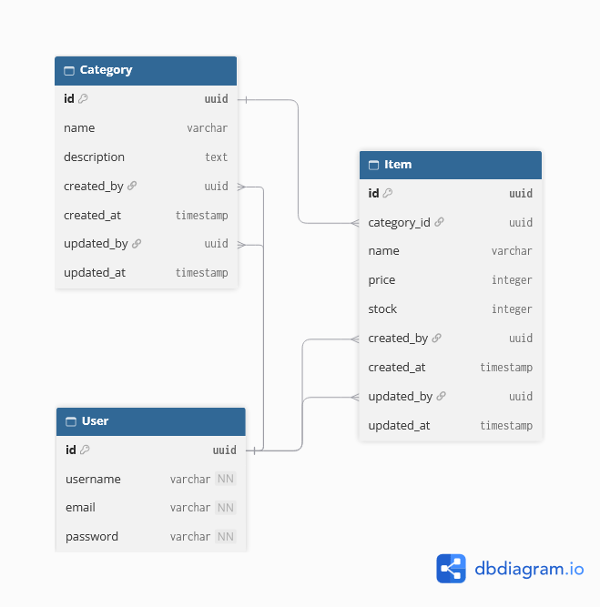

# Inventori MVC Nest

## Tentang Proyek

Itemstore API adalah API sederhana yang dapat meng-handle skenario transaksi sederhana.

## Desain Database



## Screenshot Aplikasi


## Dependency

Ensure you have the following installed:

1. **Node.js** (v26 or higher) - [Download Node.js](https://nodejs.org/)
2. **npm** (bundled with Node.js) (latest version)
3. **PostgreSQL** (v13 or higher) - [Download PostgreSQL](https://www.postgresql.org/)
4. **Git** - [Download Git](https://git-scm.com/)


## 🚦 Instalasi

### 1. Clone repositori

```bash
git clone https://github.com/rickytedjo/itemstore-api
cd ngejoblist
```
--- 
### 2. Unduh dependency projek

Run the following command to install required packages:

```bash
npm install
```

---
### 3. Siapkan environment

Create a `.env` file in the root directory. Use the `.env.example` file as a template:

```bash
cp .env.example .env
```

Fill in the necessary environment variables in the `.env` file. For example:

---

### 4. Pengaturan database

#### a. Create the Database (Opsional)
Ensure PostgreSQL is running and create a new database for the application:

```sql
CREATE DATABASE your_database_name;
```

P.S: Prisma could create a new database automatically for you if it doesn't exist.

#### b. Jalankan migrasi database

Run the Prisma migrations to set up the database schema:

```bash
npx prisma db migrate --advance-ref db   
```

---

### 5. Start the Application

Run the application in development mode:

```bash
npm run start:dev
```

---

## Kontak
Email: <rickyputra.tedjo@gmail.com>

Link Proyek: <https://github.com/rickytedjo/inventory-nest>